

  

<strong>Full-stack development with C#/.NET, Angular, and SQL</strong>

  
  
  

  <a href="#projects">Projects</a> · <a href="#experience-and-education">Experience</a> · <a href="#credentials">Credentials</a> · <a href="https://my-profile-fawn-ten.vercel.app/assets/documents/Leonel-Barros-CV.pdf">View CV</a>

## About me

I'm **Leonel Barros**, a Software Engineering student at **Universidad Técnica de Ambato**, Ecuador. I build web interfaces, APIs, and tools that work with relational data. My projects cover business workflows, real-time communication, and connected agriculture.

## Interactive portfolio

Follow the robot from the main plaza through the terraces to discover **nine projects**. Move with WASD or the arrow keys, or tap a building’s name on mobile. Each stop has screenshots, my contributions, and an optional activity. The portfolio is available in Spanish and English with Original and Liquid Glass appearances.

<a href="https://my-profile-fawn-ten.vercel.app/#mapa">
  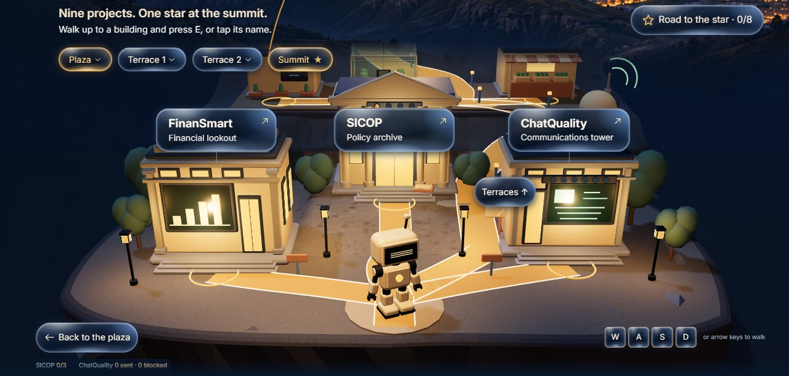
</a>

**[Start the interactive tour →](https://my-profile-fawn-ten.vercel.app/#mapa)**

## Projects

### ★ Pantufladas · Featured project

<table width="100%">
  <tr>
    <td>
      
<strong>Production, inventory, and sales management</strong>

      
<a href="https://my-profile-fawn-ten.vercel.app/?proyecto=pantufladas">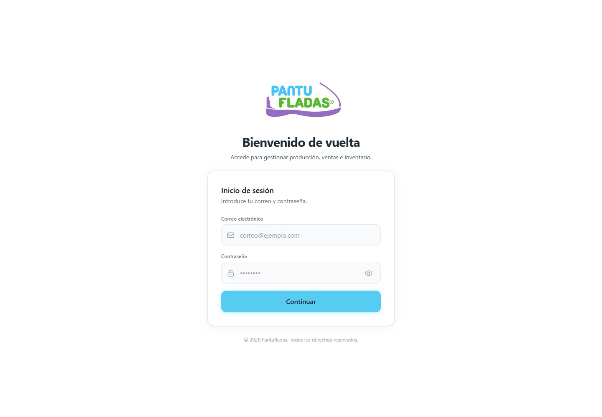</a>

      
Connects piecework production at a slipper factory with warehouse stock, goods in transit, store sales, and payroll.

      
<strong>My contribution.</strong> I worked on labor catalogs and responsive production, inventory, and personnel views. I also helped prepare the project for production and updated Angular.

      
<code>Angular</code> <code>TypeScript</code> <code>Express</code> <code>Prisma</code> <code>PostgreSQL</code>

      <a href="https://my-profile-fawn-ten.vercel.app/?proyecto=pantufladas"><strong>View project →</strong></a> · Private source code
    </td>
  </tr>
</table>

### Web and mobile applications

<table width="100%">
  <tr>
    <td width="50%" valign="top">
      <h4>FinanSmart</h4>
      <a href="https://my-profile-fawn-ten.vercel.app/?proyecto=finansmart">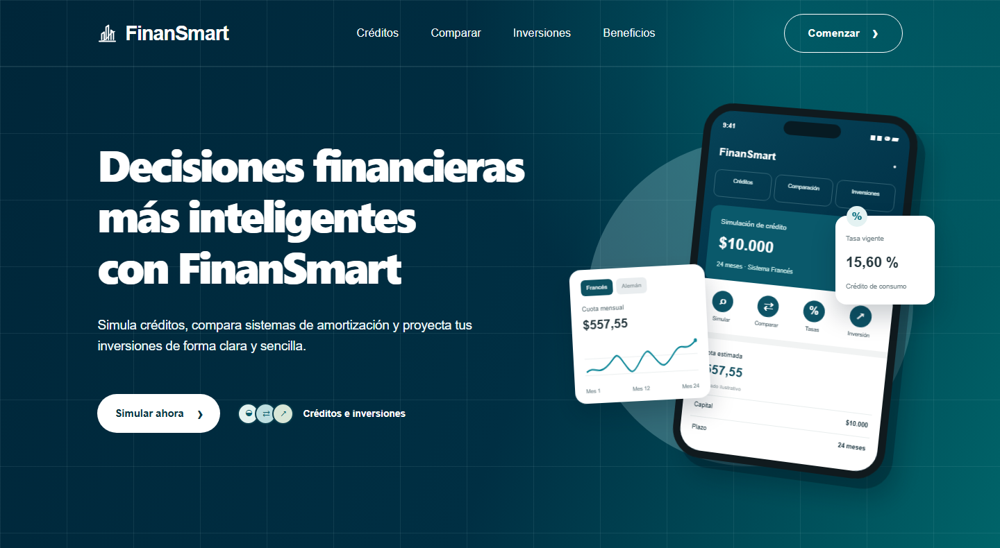</a>
      
Simulates loans with French and German amortization, compares payments, and exports results to PDF.

      
<strong>My contribution.</strong> Refactored the interface and loan simulator, including results and PDF export.

      
<code>Angular</code> <code>ASP.NET Core</code> <code>PostgreSQL</code>

      <a href="https://my-profile-fawn-ten.vercel.app/?proyecto=finansmart">View project</a> · <a href="https://github.com/Leo538/FinanSmart">View source ↗</a>
    </td>
    <td width="50%" valign="top">
      <h4>SICOP</h4>
      <a href="https://my-profile-fawn-ten.vercel.app/?proyecto=sicop">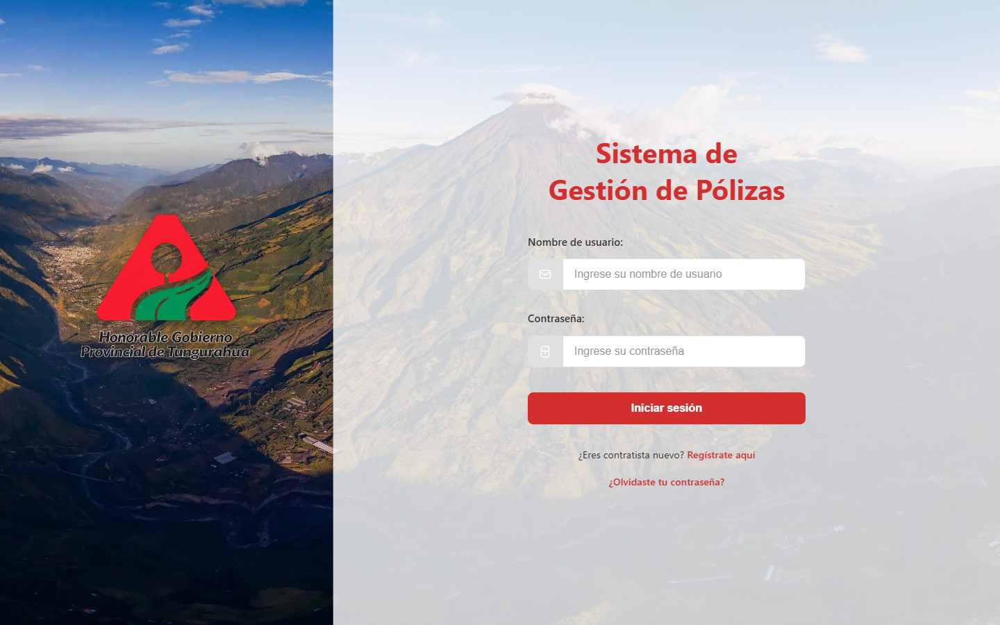</a>
      
Full-stack foundation for an insurance policy management system.

      
<strong>My contribution.</strong> Set up the frontend and backend structure, models, and routes, and implemented the responsive sign-in screen.

      
<code>Angular</code> <code>TypeScript</code> <code>ASP.NET Core</code>

      <a href="https://my-profile-fawn-ten.vercel.app/?proyecto=sicop">View project</a> · <a href="https://github.com/Leo538/Proyecto-SICOP">View source ↗</a>
    </td>
  </tr>
  <tr>
    <td width="50%" valign="top">
      <h4>ChatQuality</h4>
      <a href="https://my-profile-fawn-ten.vercel.app/?proyecto=chatquality">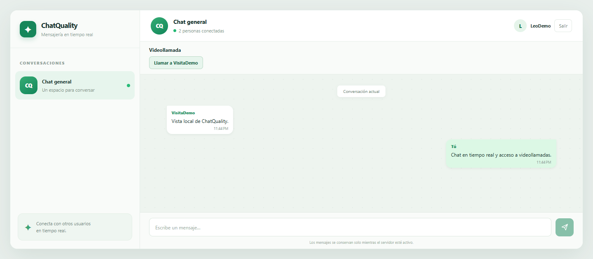</a>
      
Real-time messaging and video calls with public aliases and temporary chat history.

      
<strong>My contribution.</strong> Built the initial chat and calling flows, message validation and limits, and automated tests.

      
<code>Angular</code> <code>Express</code> <code>Socket.IO</code> <code>WebRTC</code>

      <a href="https://my-profile-fawn-ten.vercel.app/?proyecto=chatquality">View project</a> · <a href="https://github.com/Leo538/ChatQuality">View source ↗</a>
    </td>
    <td width="50%" valign="top">
      <h4>AgroPay</h4>
      <a href="https://my-profile-fawn-ten.vercel.app/?proyecto=agropay">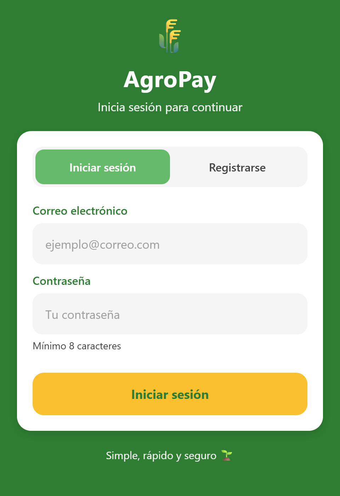</a>
      
Mobile marketplace that connects farmers and buyers to manage products, orders, and deliveries.

      
<strong>My contribution.</strong> Implemented buyer purchases and orders, plus OCR and QR payment receipt validation for farmer review.

      
<code>React Native</code> <code>Expo</code> <code>Express</code> <code>MongoDB</code>

      <a href="https://my-profile-fawn-ten.vercel.app/?proyecto=agropay">View project</a> · <a href="https://github.com/Leo538/AgroPay">View source ↗</a>
    </td>
  </tr>
</table>

### Agriculture and IoT

<table width="100%">
  <tr>
    <td width="50%" valign="top">
      <h4>Sistema de Riego</h4>
      <a href="https://my-profile-fawn-ten.vercel.app/?proyecto=riego">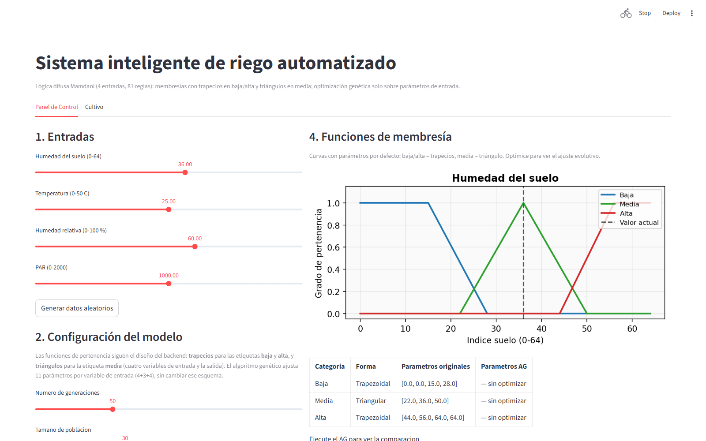</a>
      
Estimates irrigation duration from field conditions and compares a fuzzy model with its genetically optimized parameters.

      
<strong>My contribution.</strong> Built the simulation, control panel, and genetic optimization modules.

      
<code>Python</code> <code>Streamlit</code> <code>NumPy</code> <code>Fuzzy logic</code>

      <a href="https://my-profile-fawn-ten.vercel.app/?proyecto=riego">View project</a> · <a href="https://github.com/Leo538/Sistema_Riego-IA">View source ↗</a>
    </td>
    <td width="50%" valign="top">
      <h4>Vinculación de Riego</h4>
      <a href="https://my-profile-fawn-ten.vercel.app/?proyecto=vinculacion">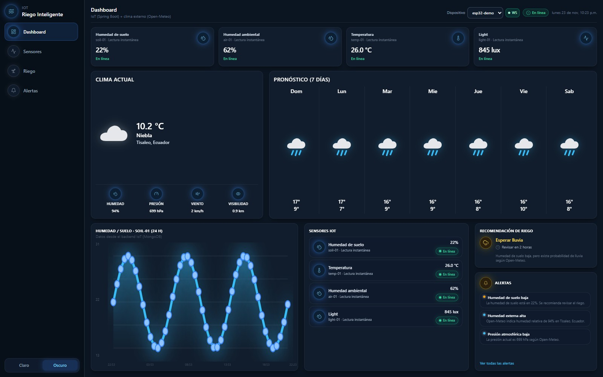</a>
      
Combines agricultural sensor readings, weather forecasts, and irrigation recommendations in one dashboard.

      
<strong>My contribution.</strong> Developed the dashboard and API integration, sensor readings and histories, and alerts.

      
<code>Next.js</code> <code>Spring Boot</code> <code>MQTT</code> <code>Open-Meteo</code>

      <a href="https://my-profile-fawn-ten.vercel.app/?proyecto=vinculacion">View project</a> · <a href="https://github.com/Leo538/Vinculacion-Sistema-Riego">View source ↗</a>
    </td>
  </tr>
</table>

### Image processing and web development

<table width="100%">
  <tr>
    <td width="50%" valign="top">
      <h4>Laboratorio RGB</h4>
      
      
Desktop image editor for RGB adjustments, histograms, cropping, and binarization.

      
<strong>My contribution.</strong> Implemented the editor, channel operations, histogram comparison, and saving results.

      
<code>Python</code> <code>OpenCV</code> <code>NumPy</code> <code>PySide6</code>

      <a href="https://my-profile-fawn-ten.vercel.app/?proyecto=rgb">View project</a> · <a href="https://github.com/Leo538/Laboratorio-rgb">View source ↗</a>
    </td>
    <td width="50%" valign="top">
      <h4>Novacore</h4>
      <a href="https://my-profile-fawn-ten.vercel.app/?proyecto=novacore">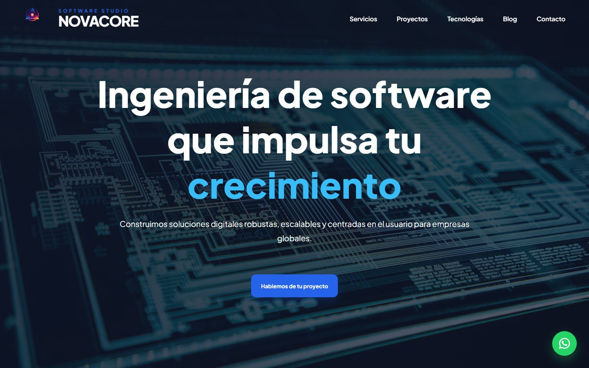</a>
      
Collaborative studio site featuring services, projects, its team, and a blog.

      
<strong>My contribution.</strong> Built the project catalog and detail pages with routes and reusable cards.

      
<code>Angular</code> <code>TypeScript</code> <code>RxJS</code> <code>PostgreSQL</code>

      <a href="https://my-profile-fawn-ten.vercel.app/?proyecto=novacore">View project</a> · <a href="https://github.com/Leo538/Novacore">View source ↗</a>
    </td>
  </tr>
</table>

## Technologies

| Area | Tools |
| --- | --- |
| Interfaces and 3D | Angular · TypeScript · Tailwind CSS · SCSS · Three.js |
| Backend and data | C# · ASP.NET Core · Node.js · Express · SQL · PostgreSQL · Oracle |
| Development and testing | Git · Docker · SonarQube · Automated tests |
| Other project tools | Python · OpenCV · Socket.IO · WebRTC |

## Experience and education

### Ambacar · Software development internship

I contributed to the **General Parameters** and **Entities** modules of **AMBYSOFT**. I worked on Angular interfaces, C#/.NET business logic, Oracle queries, and fixes to existing features.

`Angular` `C#/.NET` `Oracle` `MediatR` `FluentValidation` `Git`

### Universidad Técnica de Ambato

**Software Engineering** · Degree in progress · Ambato, Ecuador

## Credentials

<table>
  <thead>
    <tr><th scope="col">Artwork</th><th scope="col">Credential and issuer</th></tr>
  </thead>
  <tbody>
    <tr>
      <td align="center">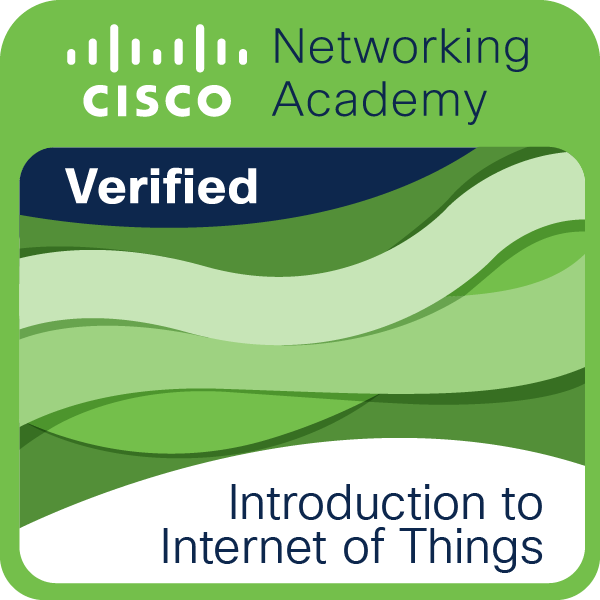</td>
      <td><a href="https://www.credly.com/badges/bca36865-b947-4b2e-b649-e52994d4a488"><strong>Introduction to IoT ↗</strong></a> Cisco Networking Academy · June 11, 2024</td>
    </tr>
    <tr>
      <td align="center">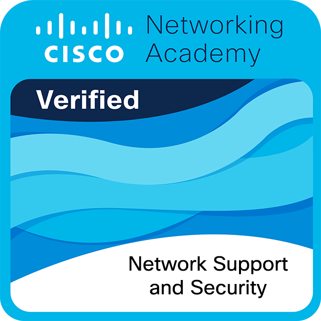</td>
      <td><a href="https://www.credly.com/badges/65ea84a4-5e54-4615-98c1-019b50fdb1d9/linked_in_profile"><strong>Network Support and Security ↗</strong></a> Cisco Networking Academy · December 21, 2024</td>
    </tr>
    <tr>
      <td align="center">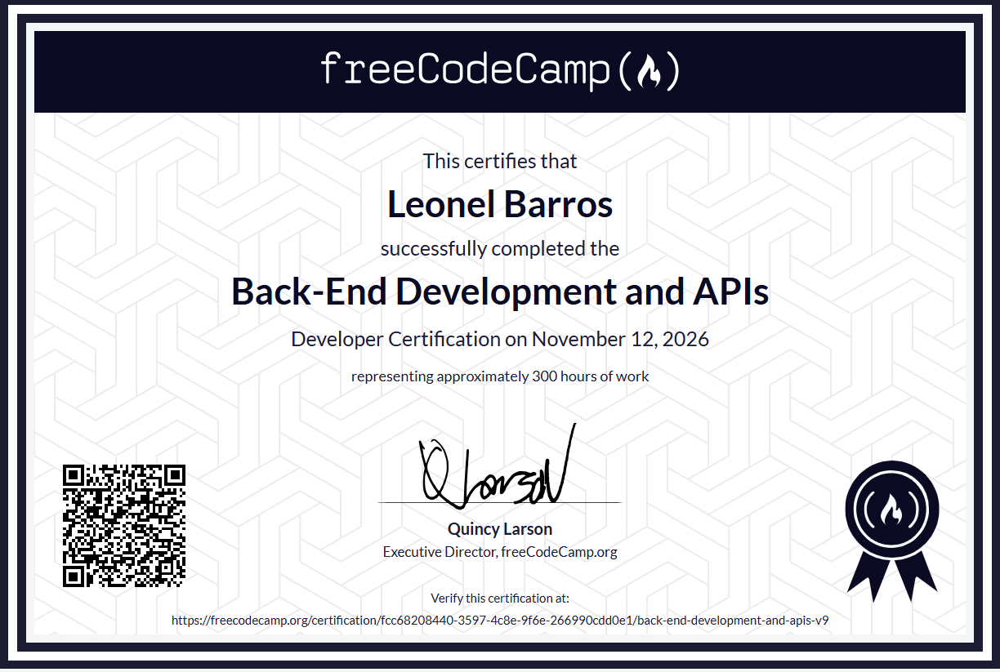</td>
      <td><a href="https://www.freecodecamp.org/certification/fcc68208440-3597-4c8e-9f6e-266990cdd0e1/back-end-development-and-apis-v9"><strong>Back-End Development and APIs ↗</strong></a> freeCodeCamp · November 12, 2026</td>
    </tr>
    <tr>
      <td align="center">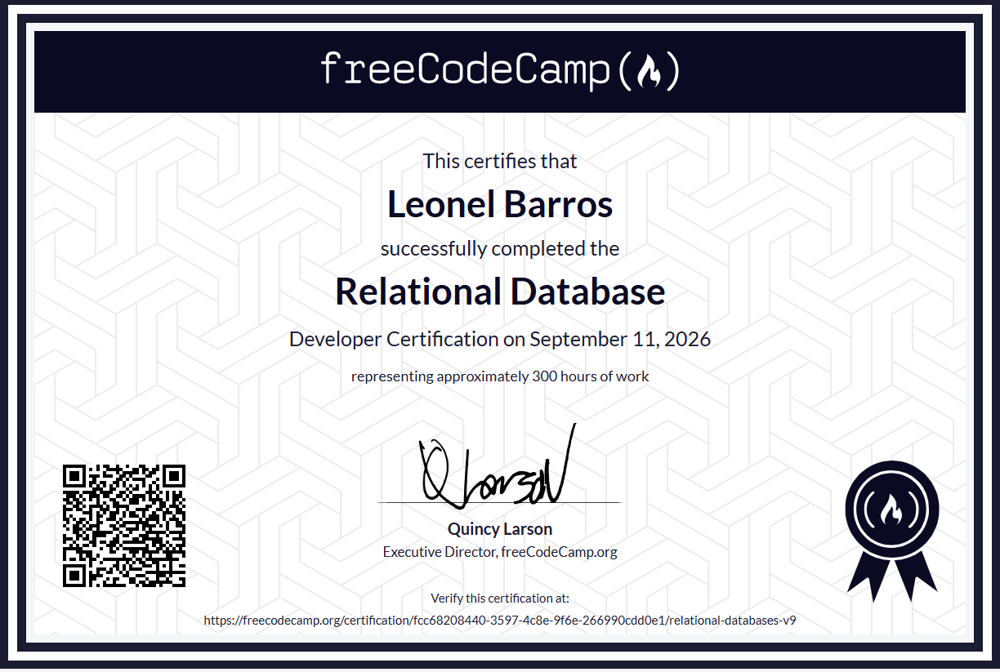</td>
      <td><a href="https://www.freecodecamp.org/certification/fcc68208440-3597-4c8e-9f6e-266990cdd0e1/relational-databases-v9"><strong>Relational Database ↗</strong></a> freeCodeCamp · September 11, 2026</td>
    </tr>
    <tr>
      <td align="center">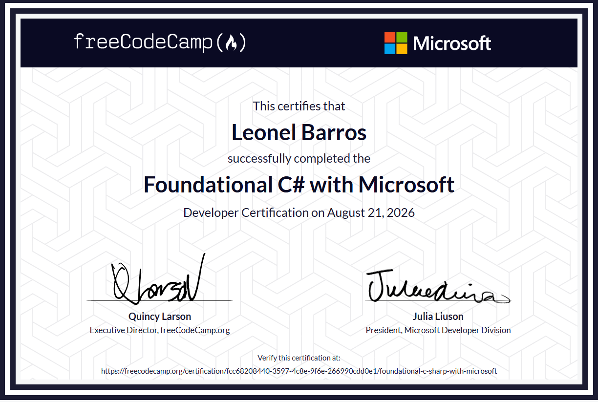</td>
      <td><a href="https://www.freecodecamp.org/certification/fcc68208440-3597-4c8e-9f6e-266990cdd0e1/foundational-c-sharp-with-microsoft"><strong>Foundational C# with Microsoft ↗</strong></a> freeCodeCamp and Microsoft · August 21, 2026</td>
    </tr>
  </tbody>
</table>

## Contact

I'm interested in collaborating on web applications, APIs, and tools that solve day-to-day problems.

**[Email](mailto:lozadaleonel15@gmail.com)** · **[LinkedIn](https://www.linkedin.com/in/leonel-barros-75b655264/)** · **[GitHub repositories](https://github.com/Leo538?tab=repositories)** · **[Portfolio](https://my-profile-fawn-ten.vercel.app/)**

Leonel Barros · Ambato, Ecuador

