

  

  <picture>
    <source media="(prefers-reduced-motion: reduce)" srcset="./assets/profile/typewriter-static.svg">
    
  </picture>

  
  
  

  <a href="#technologies">Technologies</a> · <a href="#projects">Projects</a> · <a href="#experience-and-education">Experience</a> · <a href="#credentials">Credentials</a> · <a href="https://my-profile-fawn-ten.vercel.app/assets/documents/Leonel-Barros-CV.pdf">View CV</a>

## About me

I'm **Leonel Barros**, a Software Engineering student at **Universidad Técnica de Ambato**, Ecuador. I build web interfaces, APIs, and tools that work with relational data. My projects cover business workflows, real-time communication, and connected agriculture.

## Technologies

  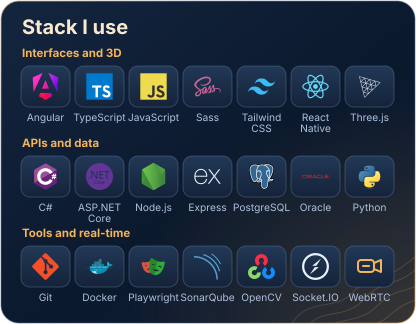
  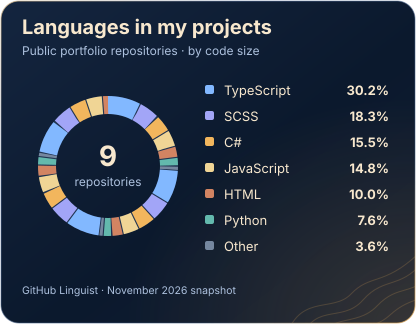

Language data from <a href="https://docs.github.com/en/rest/repos/repos#list-repository-languages">GitHub Linguist</a> · Logos from <a href="https://github.com/devicons/devicon">Devicon</a>

## GitHub activity

  <a href="https://github.com/Leo538#contribution-activity">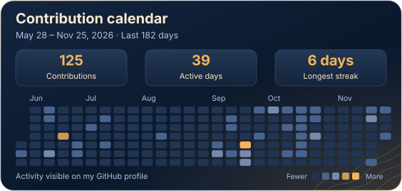</a>

## Projects

### ★ Pantufladas · Featured project

<table width="100%">
  <tr>
    <td>
      
<a href="https://my-profile-fawn-ten.vercel.app/?proyecto=pantufladas">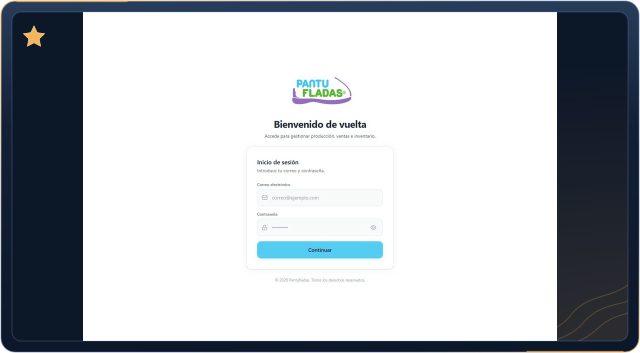</a>

      
<strong>Production, inventory, and sales management</strong>

      
Connects piecework production at a slipper factory with warehouse stock, goods in transit, store sales, and payroll.

      
<strong>My contribution.</strong> I worked on labor catalogs and responsive production, inventory, and personnel views. I also helped prepare the project for production and updated Angular.

      
<code>Angular</code> <code>TypeScript</code> <code>Express</code> <code>Prisma</code> <code>PostgreSQL</code>

      
  Private source code

    </td>
  </tr>
</table>

### Web and mobile applications

<table width="100%">
  <tr>
    <td width="50%" valign="top">
      
<a href="https://my-profile-fawn-ten.vercel.app/?proyecto=finansmart">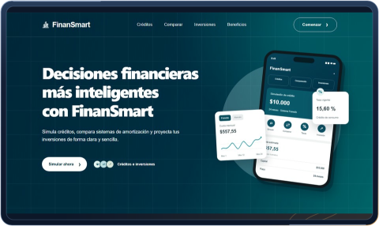</a>

      <h4 align="center">FinanSmart</h4>
      
Simulates loans with French and German amortization, compares payments, and exports results to PDF.

      
<strong>My contribution.</strong> Refactored the interface and loan simulator, including results and PDF export.

      
<code>Angular</code> <code>ASP.NET Core</code> <code>PostgreSQL</code>

      
 

    </td>
    <td width="50%" valign="top">
      
<a href="https://my-profile-fawn-ten.vercel.app/?proyecto=sicop">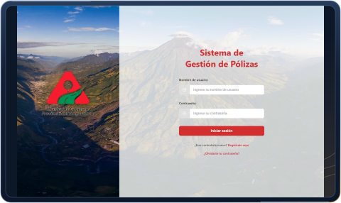</a>

      <h4 align="center">SICOP</h4>
      
Full-stack foundation for an insurance policy management system.

      
<strong>My contribution.</strong> Set up the frontend and backend structure, models, and routes, and implemented the responsive sign-in screen.

      
<code>Angular</code> <code>TypeScript</code> <code>ASP.NET Core</code>

      
 

    </td>
  </tr>
  <tr>
    <td width="50%" valign="top">
      
<a href="https://my-profile-fawn-ten.vercel.app/?proyecto=chatquality">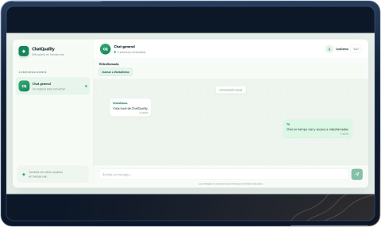</a>

      <h4 align="center">ChatQuality</h4>
      
Real-time messaging and video calls with public aliases and temporary chat history.

      
<strong>My contribution.</strong> Built the initial chat and calling flows, message validation and limits, and automated tests.

      
<code>Angular</code> <code>Express</code> <code>Socket.IO</code> <code>WebRTC</code>

      
 

    </td>
    <td width="50%" valign="top">
      
<a href="https://my-profile-fawn-ten.vercel.app/?proyecto=agropay">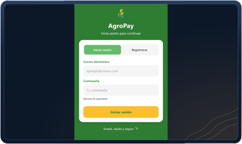</a>

      <h4 align="center">AgroPay</h4>
      
Mobile marketplace that connects farmers and buyers to manage products, orders, and deliveries.

      
<strong>My contribution.</strong> Implemented buyer purchases and orders, plus OCR and QR payment receipt validation for farmer review.

      
<code>React Native</code> <code>Expo</code> <code>Express</code> <code>MongoDB</code>

      
 

    </td>
  </tr>
</table>

### Agriculture and IoT

<table width="100%">
  <tr>
    <td width="50%" valign="top">
      
<a href="https://my-profile-fawn-ten.vercel.app/?proyecto=riego">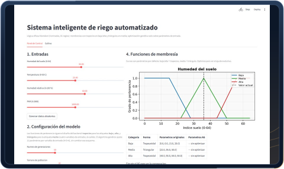</a>

      <h4 align="center">Sistema de Riego</h4>
      
Estimates irrigation duration from field conditions and compares a fuzzy model with its genetically optimized parameters.

      
<strong>My contribution.</strong> Built the simulation, control panel, and genetic optimization modules.

      
<code>Python</code> <code>Streamlit</code> <code>NumPy</code> <code>Fuzzy logic</code>

      
 

    </td>
    <td width="50%" valign="top">
      
<a href="https://my-profile-fawn-ten.vercel.app/?proyecto=vinculacion">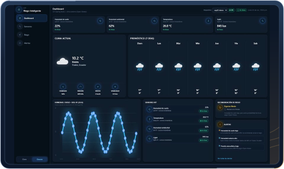</a>

      <h4 align="center">Vinculación de Riego</h4>
      
Combines agricultural sensor readings, weather forecasts, and irrigation recommendations in one dashboard.

      
<strong>My contribution.</strong> Developed the dashboard and API integration, sensor readings and histories, and alerts.

      
<code>Next.js</code> <code>Spring Boot</code> <code>MQTT</code> <code>Open-Meteo</code>

      
 

    </td>
  </tr>
</table>

### Image processing and web development

<table width="100%">
  <tr>
    <td width="50%" valign="top">
      
<a href="https://my-profile-fawn-ten.vercel.app/?proyecto=rgb">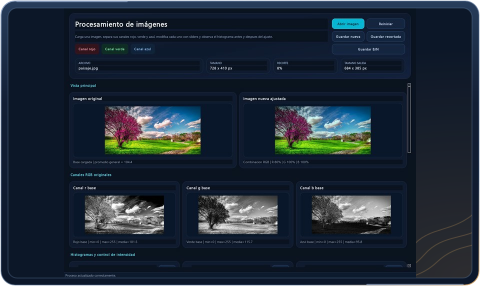</a>

      <h4 align="center">Laboratorio RGB</h4>
      
Desktop image editor for RGB adjustments, histograms, cropping, and binarization.

      
<strong>My contribution.</strong> Implemented the editor, channel operations, histogram comparison, and saving results.

      
<code>Python</code> <code>OpenCV</code> <code>NumPy</code> <code>PySide6</code>

      
 

    </td>
    <td width="50%" valign="top">
      
<a href="https://my-profile-fawn-ten.vercel.app/?proyecto=novacore">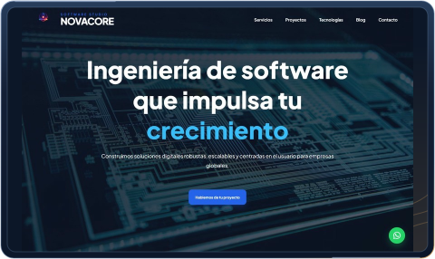</a>

      <h4 align="center">Novacore</h4>
      
Collaborative studio site featuring services, projects, its team, and a blog.

      
<strong>My contribution.</strong> Built the project catalog and detail pages with routes and reusable cards.

      
<code>Angular</code> <code>TypeScript</code> <code>RxJS</code> <code>PostgreSQL</code>

      
 

    </td>
  </tr>
</table>

## Experience and education

  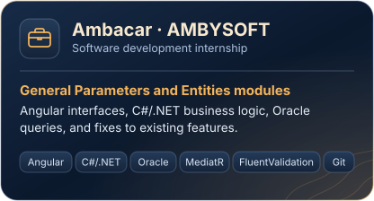
  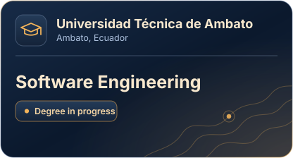

## Credentials

  <a href="https://www.credly.com/badges/bca36865-b947-4b2e-b649-e52994d4a488">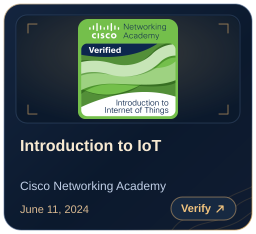</a>
  <a href="https://www.credly.com/badges/65ea84a4-5e54-4615-98c1-019b50fdb1d9/linked_in_profile">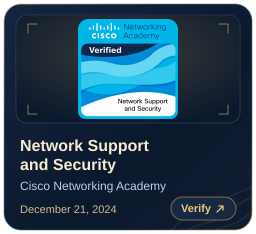</a>

  <a href="https://www.freecodecamp.org/certification/fcc68208440-3597-4c8e-9f6e-266990cdd0e1/back-end-development-and-apis-v9">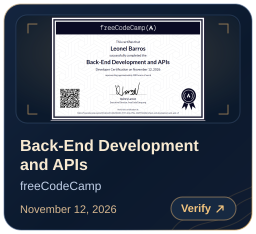</a>
  <a href="https://www.freecodecamp.org/certification/fcc68208440-3597-4c8e-9f6e-266990cdd0e1/relational-databases-v9">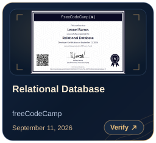</a>
  <a href="https://www.freecodecamp.org/certification/fcc68208440-3597-4c8e-9f6e-266990cdd0e1/foundational-c-sharp-with-microsoft">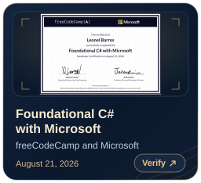</a>

## Contact

I'm interested in collaborating on web applications, APIs, and tools that solve day-to-day problems.

  
  

<a href="https://github.com/Leo538?tab=repositories">GitHub repositories</a> · <a href="https://my-profile-fawn-ten.vercel.app/">Portfolio</a> Leonel Barros · Ambato, Ecuador

